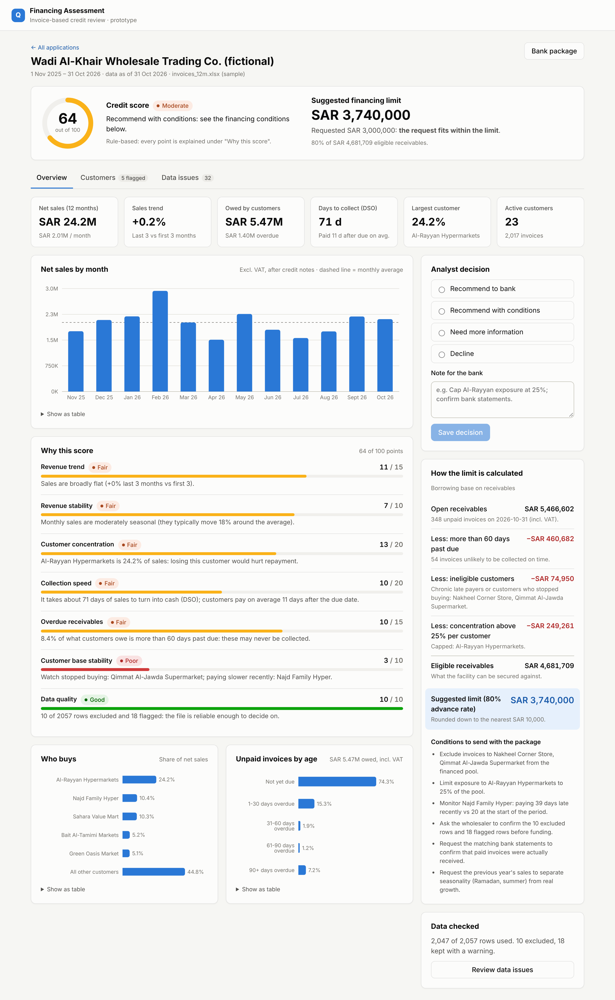

# Invoice-based financing assessment: prototype

An SME wholesaler wants financing and uploads 12 months of invoices. This prototype turns that file into a
**credit assessment a bank analyst can act on**: it checks and cleans the data, finds the risks hidden in it,
scores the business with a fully explained score, and suggests how much could be lent and on what conditions.

It answers **Task 3** of the assessment. Tasks 1, 2, 4 and 5 are in the written document.



## What "useful for a financing decision" means here

A credit analyst looking at a wholesaler's invoices needs answers to five questions. The prototype answers each
one on screen:

| Question the analyst has | What the prototype shows |
|---|---|
| Can I trust this file? | Every data problem, row by row, and what was done about it (excluded, corrected or flagged). Nothing changes silently. |
| Is the business healthy? | Monthly net sales with seasonality, trend, and stability |
| Who does the money come from? | Customer concentration: largest customer, top 5, and a per-customer table |
| Do customers actually pay? | Days sales outstanding, days paid late, and an aging of unpaid invoices. Per customer: are they paying **slower than they used to**? |
| How much can be lent, and with what conditions? | A borrowing-base calculation, step by step, plus conditions to send to the bank |

The analyst then records a decision (recommend / with conditions / need more info / decline) and opens a
**one-page bank package** that can be printed or saved as PDF.

**The score suggests; a person decides.** The score is rule-based and every point carries a plain-English
reason, so a bank can challenge any part of it. A black-box model would be hard to justify in a lending decision.

## Run it

**Option 1: Docker (one command)**

```bash
docker compose up --build
```

Open http://localhost:3000 and click **Load sample data**.

**Option 2: Run the two parts directly**

Requirements: Java 21, Maven 3.9+, Node 20+.

```bash
# terminal 1: backend on http://localhost:8080
cd backend
mvn spring-boot:run
```

```bash
# terminal 2: frontend on http://localhost:5173
cd frontend
npm install
npm run dev
```

Open http://localhost:5173. Either upload `sample-data/invoices_12m.xlsx` or click **Load sample data**.

**Tests**

```bash
cd backend
mvn test
```

The 17 tests include running the real sample file through the whole pipeline and checking that all 32 planted
data errors and all 5 planted customer stories are found, with no false alarms.

## Sample data

| File | What it is |
|---|---|
| [`sample-data/invoices_12m.xlsx`](sample-data/invoices_12m.xlsx) | 12 months (Nov 2025 – Oct 2026) of made-up invoices for a fictional Riyadh food wholesaler: about 2,000 rows, SAR 24M in sales, 24 customers |
| [`sample-data/injected_issues.md`](sample-data/injected_issues.md) | Answer key: the 32 deliberate data errors and the row each is on |
| [`data-generator/`](data-generator/) | The Python script that creates the file, and **every assumption behind the numbers** |

The data is built to be believable: Saudi 15% VAT, 30/45/60-day terms by customer type, a February peak from
Ramadan stocking, an April dip after Eid, a summer low in July, and Sunday–Thursday invoice dates. It also hides
five stories a good tool should find:

| Story | Customer | Found as |
|---|---|---|
| One customer is about 24% of sales | Al-Rayyan Hypermarkets | Largest customer, capped at 25% in the financing pool |
| Starts paying about 20 days later from May | Najd Family Hyper | Paying slower (20 d → 39 d late) |
| Pays about 36 days late on average | Nakheel Corner Store | Chronic late payer, excluded from the pool |
| Stops buying after May | Qimmat Al-Jawda Supermarket | Stopped buying, excluded from the pool |
| Starts buying in May | Al-Bustan Fresh | New customer |

All names and numbers are invented.

## How it works

```
Excel upload ─▶ Parse ─▶ Validate & clean ─▶ Store ─▶ Analyse ─▶ Dashboard / bank package
               (by header   (record every        (H2)     (metrics, score,
                name)        decision)                    financing limit)
```

| Part | Where | Responsibility |
|---|---|---|
| `ExcelInvoiceParser` | `backend/.../ingest` | Finds the invoice sheet and maps columns **by header name**, so column order and small naming differences don't matter |
| `InvoiceValidator` | `backend/.../ingest` | Business rules: duplicates, wrong period, VAT ≠ 15%, total ≠ subtotal + VAT, impossible paid dates, missing VAT numbers, customer-name variants |
| `AnalysisService` | `backend/.../analysis` | Revenue by month, trend, stability, concentration, DSO, aging, and per-customer behavior and flags |
| `RiskScorer` | `backend/.../analysis` | A 100-point score from 7 factors, each with its value, points and explanation |
| `FinancingCalculator` | `backend/.../analysis` | The borrowing base: open receivables − 60+ days overdue − risky customers − concentration above 25%, × 80% |
| REST API | `backend/.../web` | See below |
| React app | `frontend/src` | Upload, dashboard (overview / customers / data issues), decision, printable bank package |

**Stack:** Spring Boot 3.5 (Java 21), Apache POI, H2 in-memory database, React 18 + TypeScript (Vite), Recharts.

### API

| Method | Path | Purpose |
|---|---|---|
| `POST` | `/api/applications` | Upload an Excel file (`file`, optional `companyName`, `requestedAmount`) and get back the full analysis |
| `POST` | `/api/applications/sample` | Load the bundled sample file |
| `GET` | `/api/applications/sample/file` | Download the sample file |
| `GET` | `/api/applications` | List applications |
| `GET` | `/api/applications/{id}` | Full analysis |
| `GET` | `/api/applications/{id}/issues` | Data problems, row by row |
| `GET` | `/api/applications/{id}/invoices?customerKey=` | Cleaned invoices, optionally for one customer |
| `POST` | `/api/applications/{id}/decision` | Record the analyst's decision: `{ "decision": "RECOMMEND_WITH_CONDITIONS", "note": "..." }` |
| `DELETE` | `/api/applications/{id}` | Delete an application |

Errors come back as `{ status, error, message }`, with a message the user can read as-is. A file that isn't
Excel, or is missing required columns, returns `422` with the reason.

## Assumptions

The brief leaves parts open on purpose. These are the calls I made:

**Scope**
- **Invoices only (Excel).** Bank statements (PDF) are out of scope for the prototype: every bank uses a different
  layout and many PDFs are scanned images. In production I'd pull transactions through Open Banking (SAMA's
  framework) instead of parsing PDFs. Until then, the package includes the condition *"match paid invoices against
  bank statements before funding"*.
- **The user is a credit analyst** (at Qawafel or the bank) reviewing one wholesaler at a time. No login, roles or
  multi-tenant setup.
- **Data is in memory** (H2) and resets when the backend restarts. Production would use PostgreSQL and keep the
  original files in object storage for audit.

**Reading the file**
- Required columns: invoice number, invoice date, customer name, subtotal and status. Everything else is optional,
  with sensible fallbacks (due date = invoice date + terms, or + 30 days).
- The 12-month period comes from the file's *Company Info* sheet. If there isn't one, it's the 12 months ending
  with the latest month that has a real number of invoices, so a single row with a mistyped year can't shift the
  window.
- **Exclude** a row when it can't be trusted (no amount, no date, duplicate, outside the period). **Keep and flag**
  it when the sale clearly happened but a detail is off (VAT, total, paid date). Rows with an unreliable paid date
  still count as revenue but are left out of payment-speed metrics.

**Analysis**
- Revenue is measured **before VAT and after credit notes**. Receivables include VAT, because that's what
  customers owe.
- Trend = last 3 months vs first 3 months. With only 12 months there's no prior year to compare against, so
  seasonality can distort it. The package therefore asks for the previous year's sales.
- "Paying slower" compares a customer's invoices due in the last 4 months (counting unpaid overdue ones too)
  with the same customer's first 6 months. It needs a gap of at least 15 days on at least 5 invoices, so normal
  noise doesn't raise false alarms.
- Score thresholds (for example DSO ≤ 45 days = full marks, top customer > 35% = zero) and the financing
  parameters (60-day cut-off, 25% concentration cap, 80% advance rate) are **placeholder assumptions** based on
  common receivables-financing practice. In reality the bank's credit policy sets them.

## What I'd do next

1. Bank statement ingestion (Open Banking first, PDF as a fallback) and **invoice-to-payment matching**, the
   strongest check against fake invoices.
2. Verify customer VAT numbers against ZATCA and the e-invoicing (Fatoora) records.
3. Calibrate the score against real repayment outcomes, together with the bank partner.
4. Accounts, audit trail of who changed what, and secure document storage.
